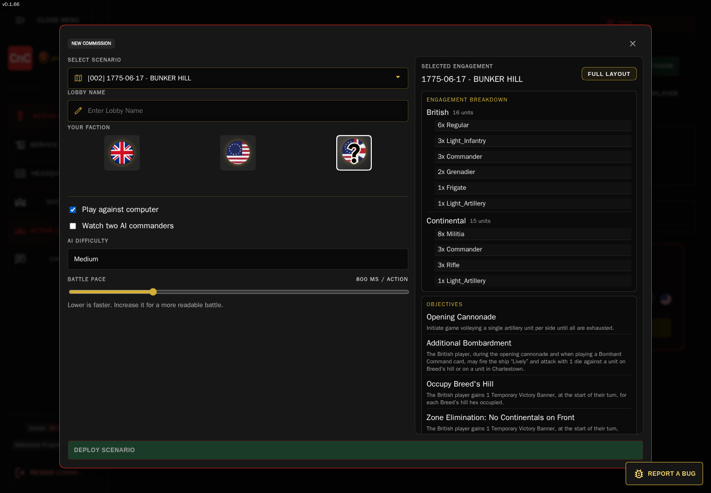
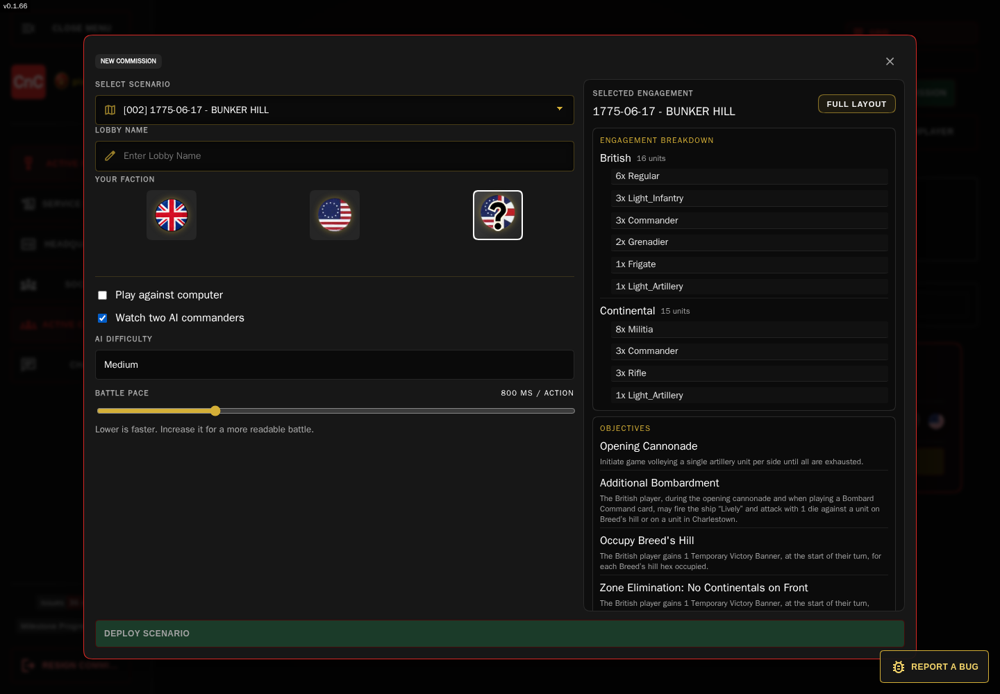

# AI Opponents: skill levels, tactics, and decision-making (Work-In-Progress)

[← Return to the Commands & Colors field guide](userguide.md)

The Tricorne AI is an active battlefield opponent, not a random move generator. It chooses from actions that are legal in the current game state, estimates their tactical and objective value, and uses a bounded search to compare short action sequences. Difficulty changes how far and how broadly it searches—and how much variation it allows among near-equal choices.

## Choose how you want to play

| Commission option | What happens |
| --- | --- |
| **Play against computer** | You command one faction; an AI commander occupies the opposing seat. Choose British, Continental, or Random as your faction. |
| **Watch two AI commanders** | Both faction seats are controlled by AI commanders. The game opens for you to observe their engagement. |

Both modes expose **AI Difficulty** and **Battle Pace**. In watch mode, the selected difficulty is assigned to both AI seats.

<figure>
  
  <figcaption>Choose an opponent strength and action pace before deploying your AI battle.</figcaption>
</figure>

<figure>
  
  <figcaption>Watch mode puts an AI commander on each side of the map.</figcaption>
</figure>

## Difficulty levels

The four settings are **Easy**, **Medium**, **Hard**, and **Brutal**. They use the same game rules and action evaluator; the settings change search depth, how many candidate sequences are kept, how future steps are discounted, and how widely the AI may vary from the top score.

| Level | Search depth | Beam width | Future-score discount | Near-best variation |
| --- | ---: | ---: | ---: | ---: |
| **Easy** | 1 step | 3 sequences | 0.80 | 0.45 |
| **Medium** | 2 steps | 5 sequences | 0.82 | 0.18 |
| **Hard** | 3 steps | 8 sequences | 0.86 | 0.06 |
| **Brutal** | 4 steps | 12 sequences | 0.90 | 0 |

**Search depth** is a short look-ahead through compatible actions in the current decision context—not a search through every future turn of the whole battle. **Beam width** is how many of the best partial sequences survive each search layer. A higher discount keeps more value on follow-up actions deeper in that sequence.

The variation value is a score window, not a chance of making an illegal move. The AI first finds the best sequence score, then—when variation is enabled—may choose among other candidates inside a tolerance based on that score. Easy therefore has a broader near-best choice window; Hard has a narrower one; Brutal selects the top-scoring candidate without score-noise selection. It does not receive extra dice or different unit statistics at higher difficulty.

**Battle Pace** is separate from difficulty. The slider controls the delay between AI actions (100–3,000 ms; the default is 800 ms). Move it lower for a faster game or higher to make each decision easier to follow.

## What happens when the AI takes a turn

1. **Wait for control.** The AI acts when its faction is allowed to act and the game is in progress. Battle Pace limits how quickly it takes another action.
2. **Build a decision view.** The AI reads the current phase, board and units, its own hand, order pool, victory totals, scenario objectives, and recent public game history.
3. **Generate legal choices for that phase.** Depending on the phase, its options can include choosing a Move First card, playing a command or combat card, ordering units, moving, attacking, retiring artillery, retreating, ignoring flags, advancing, or ending the phase.
4. **Score the choices.** Card, movement, combat, target, survival, and objective features contribute to an action score.
5. **Compare short sequences.** A lightweight simulation updates a candidate board state as the search expands. The AI keeps the strongest sequences allowed by its difficulty settings, executes the first action in the chosen sequence, and evaluates again from the updated live game state.

The opponent uses the game’s board, movement, card, and combat services to form and execute actions. For attacks, its evaluator estimates expected hits, flags, kill probability, and retaliation from dice, range, movement, traits, and leader support. These are planning estimates; actual combat still resolves through the game’s normal dice and combat process.

## How it weighs options

The evaluator combines only the features relevant to a candidate action. These are the current score coefficients; a feature value is supplied by the action generator, so a weight is not a fixed bonus every action receives.

| Feature | Score contribution | Why it matters |
| --- | ---: | --- |
| Expected damage | **+10 ×** | Rewards expected blocks removed from an enemy unit. |
| Expected losses | **−8 ×** | Penalizes expected friendly losses. |
| Expected retaliation | **−6 ×** | Accounts for likely counter-damage. |
| Expected flags | **+2 ×** | Values pressure that may force an enemy retreat. |
| Objective progress | **+9 ×** | Increases to **+10.35 ×** while behind on victory points. |
| Banner value | **+12 ×** | Prioritizes scoring progress. |
| Survival | **+5 ×** | Favors safe retreats, rallies, and staying power. |
| Defensive value | **+3 ×** | Values useful protective positions or effects. |
| Continuation, combo, card, trait, formation | **+4 ×**, **+4 ×**, **+3 ×**, **+4 ×**, **+4 ×** | Rewards useful follow-ups, card utility, special abilities, and formations. |
| Tactical value / attack priority | **+2 ×** each | Adds context for a tactically useful action or target. |
| Target priority | **+3 ×** | Helps choose a valuable defender. |
| Risk | **−5 ×** | Penalizes dangerous options. |
| Commitment | **−2 ×** normally; **−1 ×** while behind | Makes the AI more willing to commit when it needs to catch up. |

The score also applies a small penalty to ending the phase, so the AI does not pass simply because passing is safe when a useful legal action remains.

### Cards and objectives

For command cards, the AI estimates how many eligible units can actually use the card’s orders, which sections or unit types it can reach, and whether a matching scenario objective is active. It also considers useful card effects such as movement, volleys, melee bonuses, rally/reform, protection, reserve deployment, and forming a contiguous line. A card with no contextual benefit is sharply devalued; an order that can activate units on a relevant objective is more attractive.

The board simulation values its own remaining blocks at **+0.15 each**, enemy blocks at **−0.10 each**, and the victory-point margin at **+4 per point**. Objective control is added separately: permanent and turn-start permanent objectives have a base weight of **4**, and other objective types a base weight of **2**; the resulting objective score is multiplied by **5**. Occupying objective hexes, controlling relevant sections, and matching a card to an objective can therefore influence both card selection and follow-up positioning.

### Choosing a target

The combat estimator considers the attacker’s dice after movement and trait adjustments, the defender’s remaining blocks, and expected retaliation. Target priority rises for damaged or unsupported formations and for valuable units such as leaders and artillery. Friendly support, terrain protection, ignored hits or flags, and defensive traits can reduce a target’s priority. This encourages the AI to look for vulnerable targets rather than simply selecting the nearest enemy.

When the AI must choose **Retire and Rally** or stand, it compares estimated outcomes for both choices—including hits, ignored flags, rally dice, retreat distance, and possible follow-up advances or melee—and chooses the lower expected defensive cost.

## What higher difficulty does—and does not—mean

At higher settings, the AI examines more candidate steps and keeps a wider set of promising sequences for comparison. A lower-level setting is more likely to choose a good immediate action or a varied near-best option; a higher-level setting is more likely to preserve a setup that improves its later score. The levels do not change Tricorne rules, grant bonus dice, or guarantee a win.

The search is deliberately bounded and heuristic. It evaluates the current phase’s legal-action pool and a simplified simulated board; it is not exhaustive full-game analysis and does not model every possible future opponent response. That makes the four settings useful for different table paces and challenge preferences without changing the battlefield rules.
