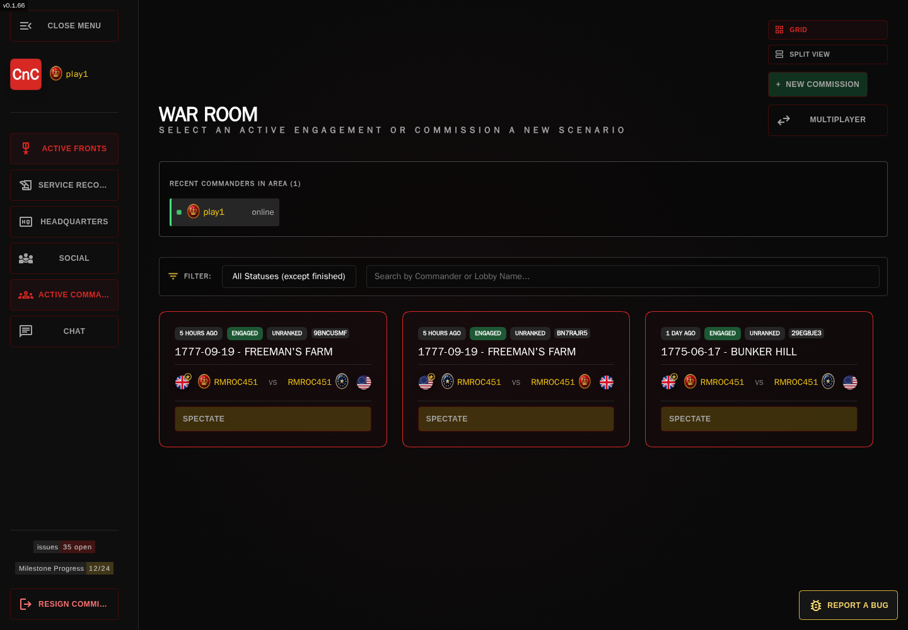
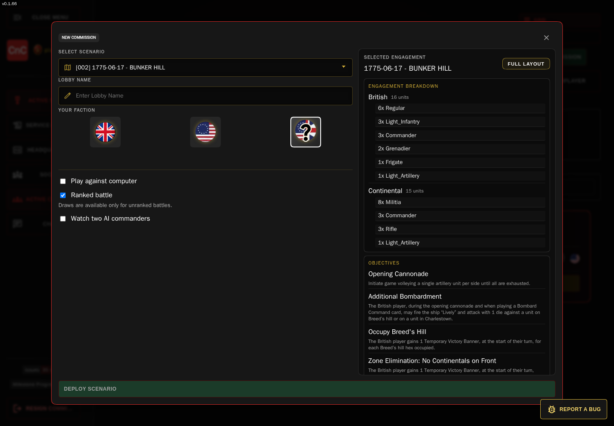
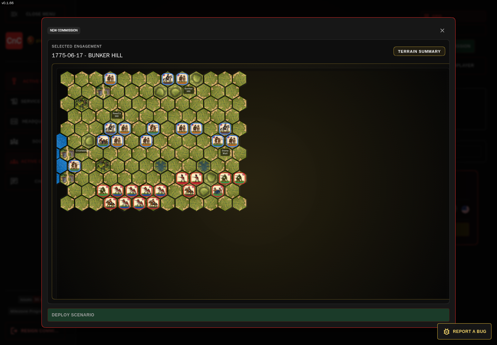
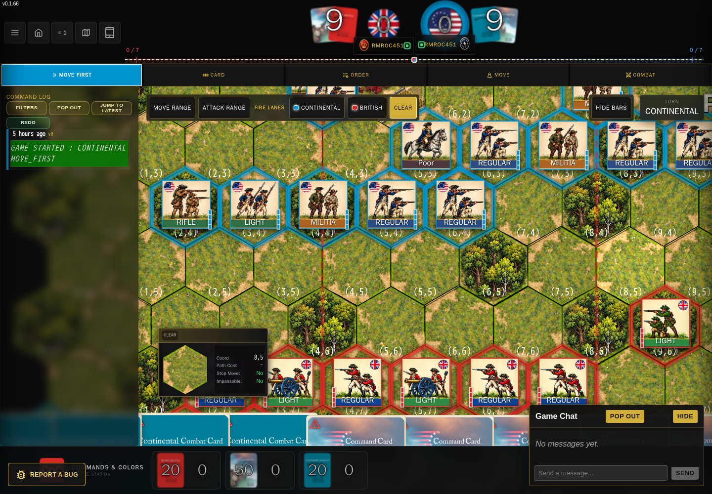
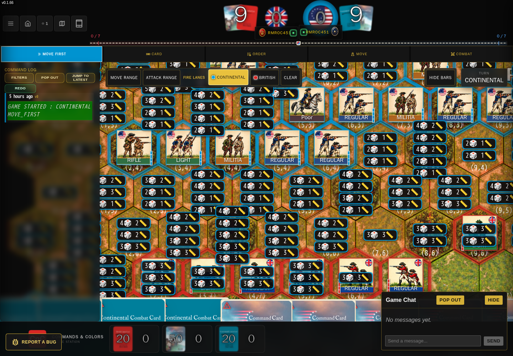
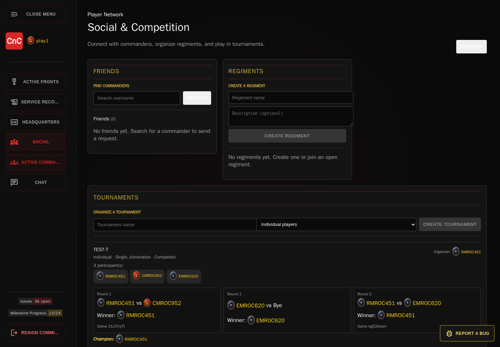
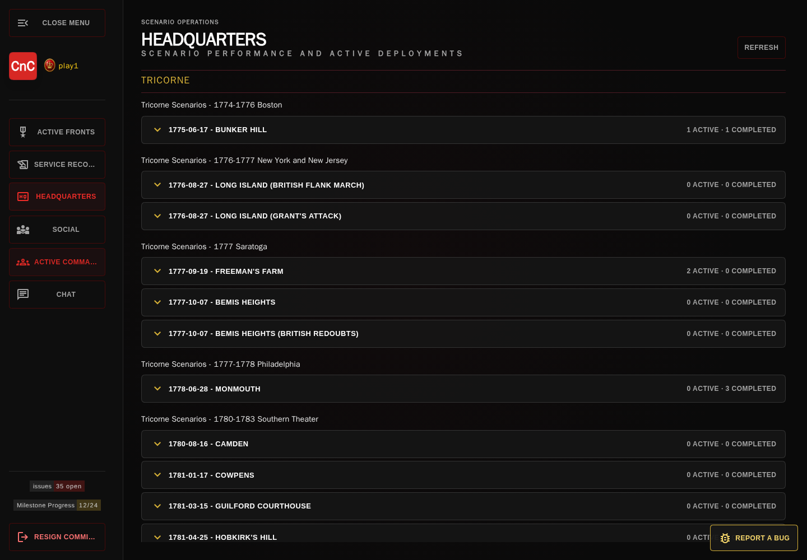
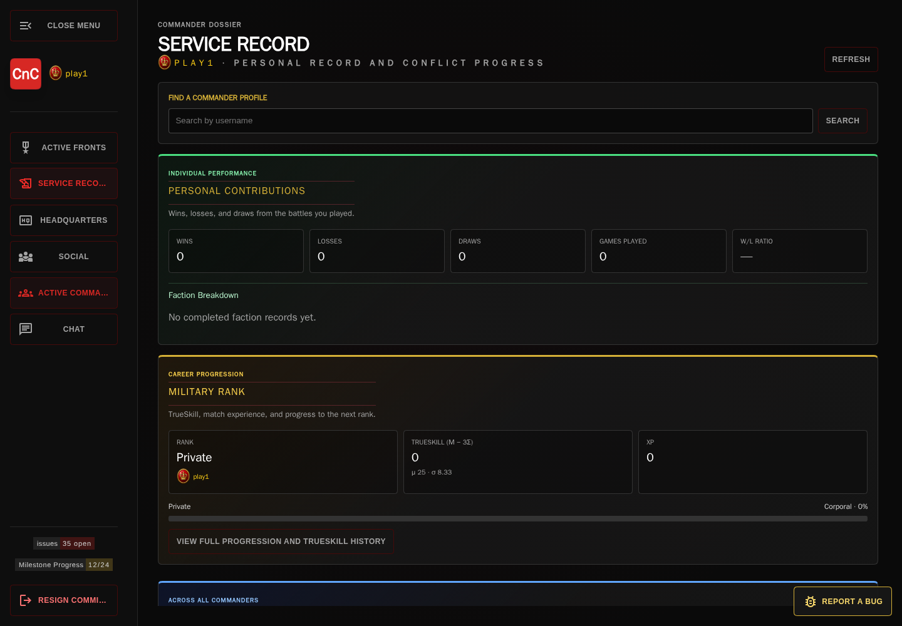
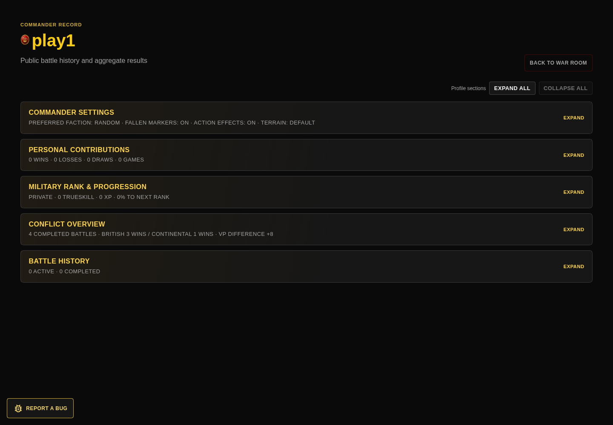
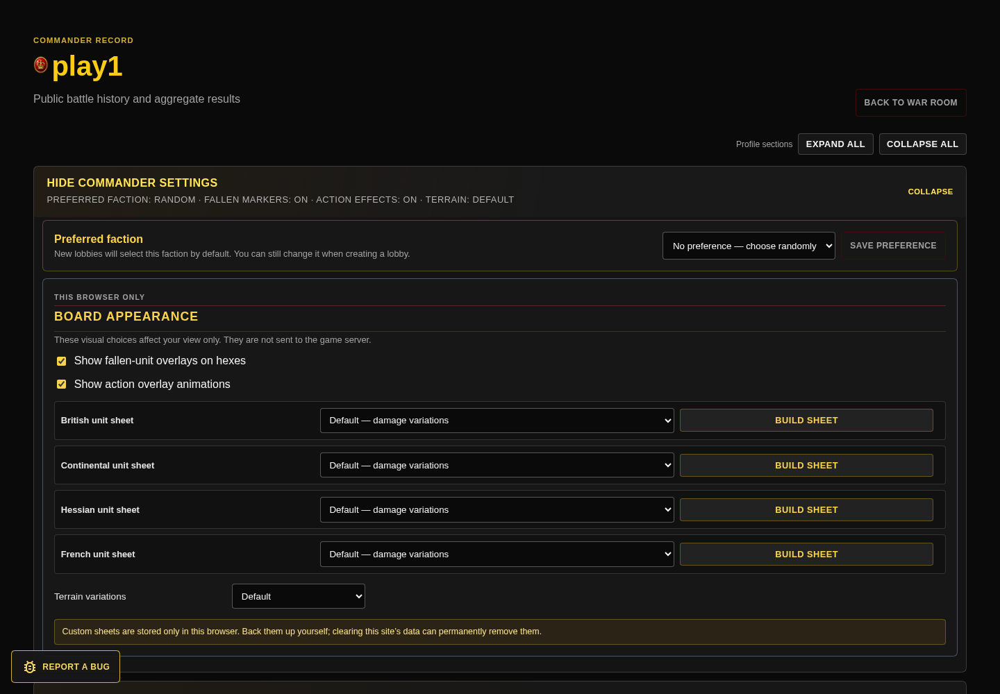

# Commands & Colors: Tricorne

## A field guide to the digital War Room

**Choose a battlefield. Take command. Watch the front come alive.**

Commands & Colors: Tricorne brings scenario selection, command cards, hex-by-hex maneuvers, combat resolution, and a community of commanders together in one browser-based table. Play against another commander, challenge a computer opponent, or sit back and spectate an engagement already under way.

> **The short version:** Browse historical engagements in the **War Room**, deploy a scenario, then use the battlefield HUD to follow cards, orders, movement, combat, and banners.

> **Found a bug? Please report it.** Use **Report a Bug** in CnC Portal, then see [how to write a useful report and add a screenshot or details later](#8-report-a-bug-and-help-improve-cnc-portal).

<figure>
  
  <figcaption><strong>The War Room</strong> — find a front to join, inspect a battle, or commission a new scenario.</figcaption>
</figure>

*Screenshots in this guide were captured with Playwright from a local demo session. Commander names, active games, scores, and available actions vary with live server data and account permissions.*

---

## 1. Muster in the War Room

After signing in, **Active Fronts** is your operations board. Its engagement cards show the scenario, status, commanders, faction markers, and whether the battle is ranked or unranked. Use the controls to make a busy front easier to scan:

- **Grid** gives each engagement its own card; **Split View** pairs a scrollable list with selected-game details.
- Filter by status, including **Recruiting**, **Engaged**, **Awaiting Deployment**, and **Finished**.
- Search by commander or lobby name.
- Open a recruiting battle with **Enlist Now**, enter a battle you are playing, or choose **Spectate** when you are observing.
- The **Active Commanders** panel shows recent commanders and their presence.

In Split View, selecting an engagement reveals its current phase, active faction, banner count, commander matchup, and tactical board preview when that state is available.

## 2. Commission a scenario

Select **New Commission** to open the scenario setup. The preview helps you understand the engagement before deployment: review the forces on each side, see the objectives, or switch from **Terrain Summary** to **Full Layout** for a hex-map view.

<figure>
  
  <figcaption>Compare the scenario’s forces and objectives before you deploy.</figcaption>
</figure>

<figure>
  
  <figcaption><strong>Full Layout</strong> previews the terrain, map labels, and starting unit positions.</figcaption>
</figure>

Your setup choices include:

| Choice | What it does |
| --- | --- |
| **Scenario** | Select an available Tricorne engagement. Examples in the scenario list include Bunker Hill, Long Island, Freeman’s Farm, Bemis Heights, Monmouth, and Cowpens. |
| **Lobby name** | Give the engagement a name commanders can recognize in the War Room. |
| **Your faction** | Choose British, Continental, or Random. |
| **AI play modes (Work-In-Progress)** | Choose **Play against computer** for human-versus-AI, or **Watch two AI commanders** to observe both sides. See the [AI opponents guide](ai-guide.md) for skill levels and how the AI evaluates moves. |
| **Ranked or unranked** | Ranked play is for eligible human multiplayer. AI battles are unranked; draws are available only in unranked games. |

When the preview looks right, select **Deploy Scenario**. In multiplayer, other commanders can enlist in a recruiting engagement. Once both sides are present, players can enter the battlefield; other commanders can spectate.

### Ranked, unranked, and ending an engagement

Ranked battles are for human-versus-human play; a ranked lobby waits for a second commander rather than allowing a ranked self-match. Computer-opponent and AI-versus-AI games are unranked. A draw is only available in an unranked two-human match.

The in-game early-end controls distinguish a result from simply leaving the board:

- **Forfeit** is an explicit concession. Confirming it ends the active two-human match, records the forfeiting commander as the loser, and awards the win to the opponent.
- **Propose Draw** is offered only in an unranked two-human match. The game records a draw with no winner.
- **Return to War Room** only navigates away from the board; it does not send a forfeit or draw result. The current live-match controls do not expose a separate **Withdraw** result. Separately, a lobby host can decommission an engagement from the War Room; that is lobby management, not a forfeit result.

Completed forfeits and draws are game results. Results marked incomplete, abandoned, or cancelled are excluded from completed-game analytics.

For a deeper explanation of Easy through Brutal, the AI’s search depth, and how it scores cards, targets, objectives, risk, and follow-up actions, see the standalone [AI opponents guide](ai-guide.md).

## 3. Read the battlefield

The battlefield combines the map, the turn’s command-card hand, faction scores, a phase indicator, and a running command log. The board uses illustrated hexes, terrain, faction-colored unit chits, and section markers to keep the action readable.

<figure>
  
  <figcaption>The live table keeps the map, turn state, cards, and command history in view.</figcaption>
</figure>

### Follow the turn

The turn ribbon guides players through **Card**, **Order**, **Move**, and **Combat**; a **Move First** selection can appear when the scenario calls for it. The active faction and order pool are shown on the board. The mirrored faction dashboard tracks each side’s banners and card piles, while the victory tracker shows progress toward the scenario’s victory requirement.

### Play cards, then command units

Open or browse your hand to inspect available cards, then play a legal card for the current phase. Command cards shape which units or sections can be ordered; combat cards and scenario abilities can matter during an engagement. The card hand supports scrolling and card selection, and a contextual action menu makes play, discard, and retrieval available on touch devices where applicable.

When card advice is available, the **Card Advisor** offers situational suggestions. The visible suggestion depends on the current card and battle context.

### Maneuver across the map

Select a unit or stack to see what it can do. Unit inspection surfaces classification, remaining blocks, movement and combat values, traits, and status; hex inspection shows terrain, coordinates, and path cost. The board also draws a movement path when you plan a route.

#### Three range tools for planning

On desktop layouts, the board toolbar offers **Move Range**, **Attack Range**, and **Fire Lanes**. These are tactical previews: they help you compare options before you commit a move or start combat.

- **Move Range** previews legal destinations for the focused unit, including movement cost, distance, and move type. Terrain and the unit’s current movement rules feed the preview.
- **Attack Range** previews the focused unit’s available targets, with the calculated dice and distance shown at each target hex.
- **Fire Lanes** compares a whole side’s firing opportunities. Choose **British** or **Continental** and the map marks opposing hexes that side can attack. If several units can reach the same target, separate firing-solution markers let you compare their dice and distance. Hover a marker to highlight its source unit and hex.
- **Clear** removes the preview and returns the map to its normal view.

The preview uses the game’s current movement and attack calculations; seeing a target is not itself an order or an attack. Touch layouts use their own map tools and inspection/action controls instead of the desktop range-preview toolbar.

<figure>
  
  <figcaption><strong>Fire Lanes</strong> makes it easy to compare which units can reach a target and with how many dice. Hover a firing solution to identify its source.</figcaption>
</figure>

For more context, map settings can show coordinates, map-point labels, terrain effects, unit identifiers, line-of-sight highlights, and faction outlines. Sound and dice animation are optional, and a terrain legend and action-highlighting key explain the map’s visual cues.

### Resolve combat together

In a multiplayer engagement, the combat panel identifies the attacker and defender and shows the dice breakdown and relevant modifiers. The sides confirm their positions; the attacker rolls, and the interface presents the results before they are applied. When required, the flow includes a defender’s **Retire and Rally** choice, leader casualty checks, rally checks, and retreat handling. The result is applied after the required checks are complete.

This keeps the resolution sequence visible to both players rather than hiding the important decisions behind a single roll. Spectators can follow the engagement without taking the players’ actions.

## 4. Keep the battle’s history and conversation close

### Command log and replay

The floating **Command Log** records game events. Expand its filters to focus on combat, orders, card actions, or traits; search the log text; and expand grouped entries to inspect their details. Available timeline controls include **Replay**, **Undo**, **Redo**, and **Jump to latest**. The log can also be opened in a separate pop-out window.

### Lobby and game chat

The War Room has lobby chat and separate channels for games you are part of. Unread badges help you spot new messages. In a chat, commanders can send messages, edit their own messages, review edit history, and pop the conversation out. Browser notifications can be enabled when supported. Game chat can stay beside the battlefield while you play.

## 5. Follow commanders and scenarios between battles

The left navigation connects the battle browser to the broader commander community:

- **Service Record** summarizes wins, losses, draws, games played, faction results, military rank, XP, TrueSkill, conflict totals, and battle history. Search for another commander’s profile from this view.
- **Headquarters** groups available scenarios and shows active and completed engagements. Where results exist, it also presents side win rates and historical games for a scenario.
- **Social** opens the application’s social hub for friends, regiments, and tournament organization.
- **Active Commanders** gives a quick view of recent commanders and presence.

### Friends, regiments, and tournaments

The **Friends** panel lets you search commanders by username, send friend requests, accept or decline incoming requests, and remove friends. **Regiments** let commanders create a named group with an optional description, join or leave groups, and transfer command to another member. Regiment participation can also be used when organizing a tournament.

**Tournaments are a work in progress.** The current Social hub includes the foundations for single-elimination events with either individual players or regiments: create an event, register a player or one of your regiments, let the organizer start it once there are enough participants, review rounds and byes, and verify a match by linking its completed game ID. The bracket advances from the verified result and can display a champion. Treat this as an evolving organizer feature rather than a finished tournament service.

Presence, lobby chat, and game-specific chat make it easier to find and coordinate with other commanders before and during a battle.

<figure>
  
  <figcaption>Search for commanders, build a regiment, or explore the tournament tools as they continue to evolve.</figcaption>
</figure>

<figure>
  
  <figcaption><strong>Headquarters</strong> — scan scenario activity and open historical results when they are available.</figcaption>
</figure>

<figure>
  
  <figcaption>The Service Record brings personal results and wider conflict progress together.</figcaption>
</figure>

Open a commander’s full profile for an expandable dossier: personal contributions, faction results, rank progression, TrueSkill history, conflict overview, and active or completed battles. A profile can also provide commander preferences for the next engagement and local visual choices for the board.

<figure>
  
  <figcaption>Expand only the profile sections you want to review.</figcaption>
</figure>

### Make the board your own

Visual extras make the map easier to read while adding a little battlefield atmosphere:

- **Fallen-unit overlays** place casualty markers on hexes where units have taken losses. Toggle them on or off in commander settings.
- **Block-by-block sprite wear**: the default multi-row unit sheets select damage artwork according to a unit’s remaining blocks, so a weakened formation looks different from a fresh one. The block indicator beside the chit and the unit inspector give you the numbers too. Choose **Legacy — one-row appearance** if you prefer the older, uniform look.
- **Action overlays** animate battlefield activity such as marching, firing, retreating, or taking fire. Turn them off if you prefer a quieter map.
- **Faction unit sheets** can be set independently for British, Continental, Hessian, and French units. Use the bundled damage-variation sheet, the legacy sheet, or a custom sheet you upload/build.
- **Terrain variations** switch between the default and classic sheets.

<figure>
  
  <figcaption>Board appearance options live in the commander profile and can be previewed without changing the shared game state.</figcaption>
</figure>

Custom unit sheets are PNGs stored in this browser; the builder supports the faction sheet layout, and the profile accepts one-row or four-row sheets. These appearance choices are local to the browser, not sent to the game server. Per-game overrides can temporarily show or hide fallen-unit markers and action animations for one battle without changing your profile defaults.

## 6. TrueSkill and competitive integrity

### A rating that includes uncertainty

The Service Record and commander profile display **TrueSkill** as a competitive skill estimate. The profile shows the mean rating (**μ**) and uncertainty (**σ**), plus a conservative score of **μ − 3σ**. That conservative estimate is used in the displayed military-rank progression alongside earned XP; rating and rank are related, but they are not the same number.

Ratings are based on completed, eligible human-versus-human ranked results. Computer games and self-play do not count as rated matches. Team outcomes and draws are accounted for, and the profile can chart rating history over selectable time windows. XP progression separately reflects match contributions such as units taken, victory points, objective points, and a win bonus.

### Rating-integrity review, not an automatic verdict

The application includes a **rating-integrity review** for patterns that could indicate competitive rating manipulation. It looks across recent rated results for combinations of signals—for example:

- the same opponents meeting repeatedly, with results strongly favoring one account;
- repeated forfeits that transfer results to the same opponent;
- unusually imbalanced accepted game-state activity;
- repeated low-scoring losses compared with that commander’s history in comparable scenarios and factions; or
- several accounts repeatedly transferring wins to one recipient through forfeits or very low-scoring losses.

A review flag is a reason for an administrator to look more closely, **not proof of cheating**. A single surprising result does not by itself establish a pattern. The review queue is restricted to administrators, and the interface describes the process as review-only: eligible results remain rated while a flag is being reviewed. Administrators can dismiss a flag, mark a recurring matchup as expected, or exclude/restore a result’s rating with a recorded reason. The underlying game result remains part of history.

This is a safeguard for competitive rating integrity, not an automatic gameplay ban system.

## 7. Play comfortably on a smaller screen

The game includes tablet mode, touch-oriented map tools, inspection panels, and a hand designed for swipe or scroll navigation. On touch layouts, select a unit or hex to open contextual actions such as inspect, edit, select a unit or stack, and attack when available. The **Install** control appears when the browser offers app installation.

For a clearer view on any screen, open **Map Settings** and enable only the map details you need. The tablet-mode control and **Hide bars** option provide additional space for the battlefield.

## 8. Report a bug and help improve CnC Portal

Bug reports help improve the rules, interface, and reliability of the portal. If something behaves unexpectedly, use **Report a Bug** in CnC Portal. A useful report lets another person understand what happened and, when possible, reproduce it.

1. Give the report a short, specific **Title** and describe the problem.
2. Add the steps that led to it. Include the scenario, game phase, relevant units or cards, and what you clicked or selected when those details matter.
3. Describe what you expected and what happened instead. Choose the closest **Severity**.
4. Leave **Try to attach a screenshot** selected if a picture would help, then select **Submit Report**.

The portal may include available game context, recent history, browser details, and synchronization diagnostics with the report. Screenshot capture and automatic attachment during issue creation are a **work in progress**: the portal will try, but a screenshot may not be captured or appear on the GitHub issue. The report can still be submitted without one.

After submission, select **Open issue** to view the public GitHub issue. If you do not see that link, use **View Bugs** in the report panel and look for the issue by its title. You can also [open the public issue tracker](https://github.com/rmroc451/commands-and-colors-issues/issues) directly. If the portal cannot submit your report, use GitHub’s [bug report form](https://github.com/rmroc451/commands-and-colors-issues/issues/new?template=bug_report.md).

### Add details or a missing screenshot to an existing issue

You do not need to create a duplicate issue to add evidence later:

1. Open the issue using **Open issue** or find it in the issue tracker.
2. Sign in to GitHub if prompted, then go to the comment box at the bottom of the issue.
3. Add any extra reproduction details. To add a screenshot, drag the image into the comment box or paste it there, wait for GitHub to finish uploading it, and then post the comment.

Issues in this tracker are public. Before submitting, check that your description and screenshot do not expose passwords, private messages, or personal information.

## A quick first sortie

1. Sign in and open **Active Fronts**.
2. Browse recruiting battles, or select **New Commission** to choose a scenario.
3. Compare the armies and objectives; open **Full Layout** to study the starting map.
4. Choose a faction and game mode, then deploy.
5. Follow the turn ribbon, play a card, order units, and use the map previews to plan movement and attacks.
6. Review combat results, required checks, and the command log as the engagement unfolds.

> **Availability note:** Actions depend on your role in the engagement. Players receive command controls for their side; spectators can observe. Scenario statistics and commander records grow as completed results are recorded.

---

*A digital tabletop for Commands & Colors fans: historical scenarios, clear tactical feedback, shared combat resolution, and a War Room that keeps the community connected.*
